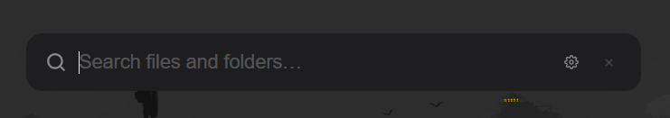
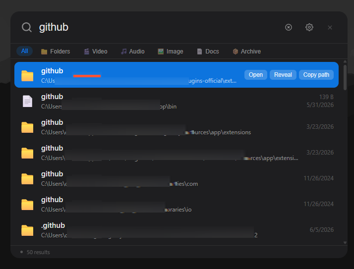
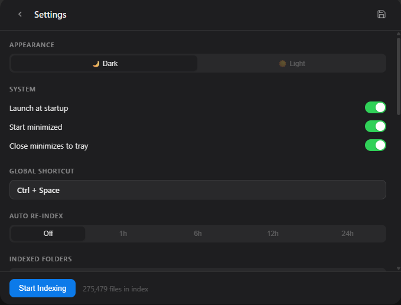

# LocaFetch

A blazing-fast file search launcher for Linux. Press a shortcut, type, find.

> Looking for the Windows version? It lives at [chamalkalakshan/LocaFetch](https://github.com/chamalkalakshan/LocaFetch).


---

## What is LocaFetch?

LocaFetch is a keyboard-driven file search utility for Linux. Press **Ctrl + Space** from anywhere on your desktop and a clean search bar appears. Start typing and results show up instantly, powered by a local SQLite full-text index. Press **Escape** and it hides to the system tray, staying out of the way until you need it again.

It indexes your home folder on first run, keeps the index live with a file system watcher, and never connects to the internet. Everything runs locally.

---

## Features

| Feature | Description |
|---|---|
| **Instant search** | FTS5 trigram index, results appear as you type |
| **Filter by type** | Chips to narrow results to Folders, Video, Audio, Images, Docs, or Archives |
| **Right-click context menu** | Open, Open with…, Show in folder, Copy path |
| **Open with…** | XDG desktop portal app chooser for any file |
| **Live index updates** | File watcher keeps the index in sync - deletions, renames, and new files update within 2 seconds |
| **Show in folder** | Opens your file manager (Dolphin, Nautilus, Nemo…) with the file highlighted |
| **System tray** | Runs silently in the background, no taskbar clutter |
| **Light / Dark theme** | Toggle in Settings, saved across sessions |
| **Launch at startup** | Optional autostart via `~/.config/autostart` desktop entry |
| **Custom hotkey** | Change the global shortcut to anything you like |
| **Auto re-index** | Schedule periodic full re-scans (1h / 6h / 12h / 24h) |
| **Portable** | Single AppImage, runs on any modern distro |

---

## Preview







---

## Installation

### Option 1: Package (recommended)

Download the `.deb` (Debian/Ubuntu) or `.rpm` (Fedora/openSUSE) from the [Releases](../../releases) page and install it with your package manager:

```bash
sudo apt install ./LocaFetch_0.1.0_amd64.deb      # Debian / Ubuntu
sudo dnf install ./LocaFetch-0.1.0-1.x86_64.rpm   # Fedora
```

### Option 2: AppImage (portable)

Download `LocaFetch_0.1.0_amd64.AppImage` from the [Releases](../../releases) page, make it executable, and run it:

```bash
chmod +x LocaFetch_0.1.0_amd64.AppImage
./LocaFetch_0.1.0_amd64.AppImage
```

No installation required. Your index and settings are stored in `~/.local/share/com.locafetch.app`.

### Requirements

- WebKitGTK 4.1 (`webkit2gtk-4.1` / `libwebkit2gtk-4.1-0`) - preinstalled on most desktop distros, pulled in automatically by the `.deb`/`.rpm`
- `libayatana-appindicator` for the system tray icon

---

## Quick Start

### 1. Launch LocaFetch

Start it from your app menu or run `locafetch`. The app starts in the system tray (look for the LocaFetch icon near the clock).

### 2. Open the search bar

Press **Ctrl + Space** anywhere on your desktop.

### 3. First run indexing

On first launch, LocaFetch indexes your home folder in the background. A status indicator shows progress. This may take a few minutes depending on the number of files.

To manage indexed locations manually:
1. Press **Ctrl + ,** or click the gear icon to open Settings
2. Under **Indexed Folders**, add or remove folders (**Add all drives** adds `/`; system folders like `/usr`, `/proc` and `/var` are excluded by default)
3. Under **Excluded Folders**, add paths to skip
4. Click **Start Indexing** to rebuild

### 4. Search

Start typing. Results appear immediately. The index uses trigram full-text search, so searching `veng` will find `Avengers`.

### 5. Filter by type

Use the chips at the top of the results list:
- **All** - everything
- **Folders** - directories only
- **Video** - mp4, mkv, avi, mov, webm, wmv
- **Audio** - mp3, flac, wav, aac, ogg
- **Image** - jpg, png, gif, webp, svg, heic
- **Docs** - pdf, docx, xlsx, txt, md, csv
- **Archive** - zip, rar, 7z, tar, gz

### 6. Act on results

| Action | How |
|--------|-----|
| Open file | Click the result or press **Enter** |
| Open with… | Right-click the result → **Open with…** |
| Show in folder | Click **Reveal** or right-click → **Show in folder** |
| Copy path | Click **Copy** or right-click → **Copy path** |
| Navigate results | Up and Down arrow keys |
| Dismiss | Press **Escape** |

---

## Settings

Open Settings with **Ctrl + ,** or the gear icon.

### Appearance

Toggle between **Dark** and **Light** theme. The change applies instantly.

### System

| Setting | Default | Description |
|---------|---------|-------------|
| Launch at startup | On | Starts LocaFetch with your desktop session |
| Start minimized | On | Window stays hidden on launch |
| Close minimizes to tray | On | The X button hides instead of quitting |

### Global Shortcut

Change the keyboard shortcut:
1. Click the shortcut box
2. It turns blue and prompts you to press a combination
3. Hold your modifier keys (Ctrl, Alt, Shift, or Super) and press a key
4. Click **Apply** to confirm

Supported modifiers: Ctrl, Alt, Shift, Super

Supported keys: A-Z, 0-9, F1-F12, Space, Enter, Tab, Escape, Delete, Backspace

### Auto Re-index

Schedule periodic full re-scans:
- **Off** - manual only
- **1h / 6h / 12h / 24h** - background re-scan every N hours

### Indexed Folders

Add the drives or folders you want searchable. Click **Add all drives** to auto-populate.

### Excluded Folders

Folders added here are skipped. LocaFetch also automatically skips:

- Virtual and runtime filesystems: `/proc`, `/sys`, `/dev`, `/run/user`, `/tmp`
- System directories: `/usr`, `/boot`, `/var`, `/snap`, `/lost+found`
- `node_modules`, `.git`, `__pycache__`, `.next`
- `target/debug`, `target/release`
- Generic `cache` directories

---

## How It Works

The indexer walks your configured folders using walkdir and writes file records into a SQLite database with FTS5 trigram search. The file watcher uses the notify crate to listen for changes and updates the index in real time. The frontend communicates with the Rust backend via Tauri invoke calls.

- **Indexer** (indexer.rs) - walks folders, batches 500 rows per SQLite transaction
- **FTS5 trigram** - enables substring search, falls back to LIKE for short queries
- **File watcher** (watcher.rs) - debounces events and flushes to DB every 2 seconds; handles create, delete, rename
- **Open with** - uses the XDG desktop portal's app chooser; **Show in folder** uses the `org.freedesktop.FileManager1` D-Bus service
- **Frontend** (React + TypeScript) - dynamically resizes the window to fit content; clears on each open

---

## Building from Source

### Prerequisites

- [Rust](https://rustup.rs/) stable toolchain
- [Node.js](https://nodejs.org/) 18 or later
- WebKitGTK build dependencies and the tray library:

```bash
# Arch / CachyOS
sudo pacman -S --needed webkit2gtk-4.1 base-devel curl wget file openssl librsvg libayatana-appindicator nodejs npm
# Debian / Ubuntu
sudo apt install libwebkit2gtk-4.1-dev build-essential curl wget file libssl-dev librsvg2-dev libayatana-appindicator3-dev nodejs npm
# Fedora
sudo dnf install webkit2gtk4.1-devel openssl-devel curl wget file librsvg2-devel libayatana-appindicator-gtk3-devel nodejs npm
```

### Steps

```bash
git clone https://github.com/chamalkalakshan/LocaFetch-Linux.git
cd LocaFetch-Linux
npm install
npm run tauri dev
```

To produce a release build:

```bash
npm run tauri build
```

This produces `.deb`, `.rpm` and `.AppImage` bundles under `src-tauri/target/release/bundle/`.
On rolling-release distros (Arch, CachyOS) the AppImage step can fail with `failed to run linuxdeploy`; build it with `NO_STRIP=true npm run tauri build`.

### Linux behaviour
- Your home folder is indexed on first run; **Add all drives** adds `/` (system folders like `/usr`, `/proc` and `/var` are excluded by default).
- **Open**, **Show in folder** and **Open with…** use `xdg-open`, the `org.freedesktop.FileManager1` D-Bus service (Dolphin, Nautilus, Nemo…) and the XDG desktop portal's app chooser.
- **Launch at startup** writes `~/.config/autostart/locafetch.desktop`.
- **Wayland:** apps can't grab global shortcuts, so Ctrl + Space only works on X11. On Wayland, bind a shortcut to the `locafetch` command in your desktop's settings (KDE: System Settings → Shortcuts → Add Command; GNOME: Settings → Keyboard → Custom Shortcuts). Running `locafetch` while it's already open toggles the search bar. Wayland compositors also choose where the window appears.

---

## Keyboard Reference

| Shortcut | Action |
|----------|--------|
| **Ctrl + Space** | Toggle search window (customizable) |
| **Up / Down** | Navigate results |
| **Enter** | Open selected file |
| **Escape** | Clear query and hide window |
| **Ctrl + ,** | Open Settings |
| **Right-click** | Context menu - Open with, Reveal, Copy path |

---

## Contributing

Contributions are welcome. Please open an issue first to discuss what you want to change.

---

## Contributors

| Name | Role |
|------|------|
| [chamalkalakshan](https://github.com/chamalkalakshan) | Creator and maintainer |

---

## License

MIT. See [LICENSE](LICENSE) for details.
